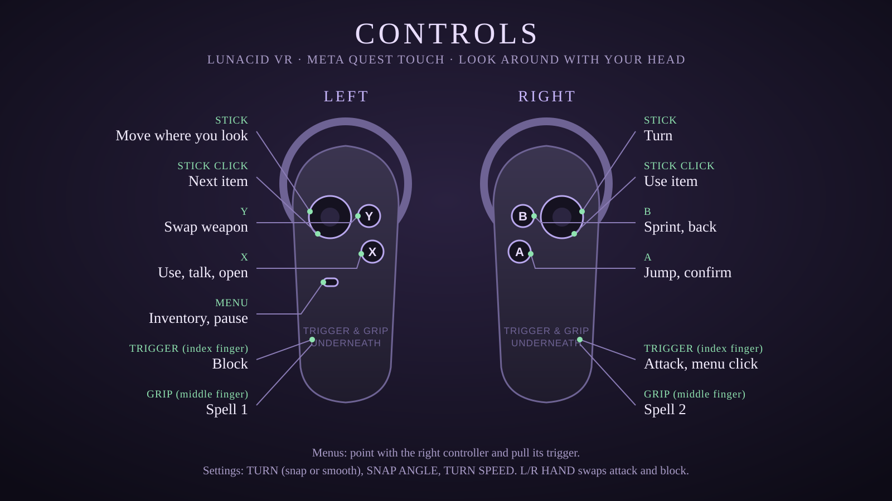

# Lunacid VR (Quest 3 / 3S)

A port of [Lunacid](https://store.steampowered.com/app/1745510/) to the Meta Quest, built on your own computer
from **your own copy of the game**. This repository holds only tools and the port's own code: no game files.
Everything game-derived is made locally, from your copy, and stays on your machine.

Works on **macOS** and **Windows**. You need about **40 GB free** and a few hours the first time (most of it
waiting on Unity).

## What you need

| | Where | Notes |
|---|---|---|
| Python 3.9+ and Git | python.org, git-scm.com | On Windows, type `py` where this page says `python3` |
| Unity **6000.0.85f1** with **Android Build Support** | Unity Hub (Installs, Add modules) | Tick the Android SDK & NDK and OpenJDK inside it. Sign in to Unity Hub once (a free Personal licence is enough): builds need an active licence |
| .NET 8 SDK | see `tools/shader_gen/README.md` | Builds the shader decompiler. It can live in `<work>/tools/dotnet`, no admin needed |
| AssetRipper **2.0.0** (`AssetRipper.GUI.Free`) | AssetRipper's GitHub releases | Turns the game into a Unity project |
| SteamCMD | Valve's developer wiki | Downloads the exact game version the port was made for |
| A Quest in developer mode | Meta Horizon app on your phone | Then allow USB debugging in the headset the first time you plug it in |

Put the work folder and the Unity project on an **internal disk**. External and exFAT disks work but are slow,
and a bumped cable mid-build costs you the build. `doctor` warns about both.

## 1. Configure

```
git clone <this repository>
cd <the repository's folder>
cp local.example.json local.json
```

Edit `local.json` (it stays on your machine and is never committed):

- `work`: a folder for everything the tools make (for example `~/lunacid-work`)
- `project`: where the Unity project will be, `<work>/project/ExportedProject`
- `game_data`: the game's `LUNACID_Data` folder (step 2)
- `assetripper`: the path to `AssetRipper.GUI.Free`

Leave out `unity`, `android_sdk`, `android_ndk` and `jdk` to use Unity Hub's default install. `python3 core/config.py`
prints what every path resolved to.

## 2. Get the game files

The port was made for one version of the game: Steam build 24780950. SteamCMD can download that exact version
with your own Steam account, even after the game updates on Steam. You keep playing the current version on PC.

`python3 lunacid_vr.py doctor` prints the command. It looks like this:

```
steamcmd +@sSteamCmdForcePlatformType windows +login <your Steam user> +download_depot 1745510 1745511 9110162109347716163 +quit
```

Type your own Steam user name. SteamCMD itself asks for your password and Steam Guard code. **These tools
never read, receive or store your Steam credentials.** The files land in SteamCMD's
`steamapps/content/app_1745510/depot_1745511/`. Set `game_data` to the `LUNACID_Data` folder inside it.

An existing Steam install also works if it is that same version. `doctor` checks the files' fingerprints either way.

## 3. Check the machine

```
python3 lunacid_vr.py doctor
```

Every line should say `OK` (`WARN` lines are advice). Fix every `FAIL` before going on.

## 4. Make the Unity project (first time only)

```
python3 tools/extract/assetripper.py --out <work>/project
python3 tools/shader_gen/make_shaders.py --work <work> --data <game_data>
```

The first exports the game into `<work>/project/ExportedProject` (about 7 minutes). The second rebuilds the
game's shaders from your copy for the Quest.

## 5. Build

```
python3 lunacid_vr.py build
```

The build applies the port's changes to the project, runs Unity and checks the result. It fails on any compile
error or missing scene. The first build also imports the whole project, so expect one to two hours. The APK and
OBB land in `<work>/builds/<date-time>/`.

After changing only the port's code, `python3 lunacid_vr.py build --fast` reuses the last full build's assets.

## 6. Install on the Quest

Plug the Quest in by USB (or connect adb over Wi-Fi), then:

```
python3 lunacid_vr.py install
```

Install does these steps in order:

1. Checks the APK is signed by this machine's key.
2. Backs up your saves.
3. Copies the game data (OBB) only when it changed.
4. Updates the app.
5. Checks every save is still there.

**It never uninstalls the app, because uninstalling deletes the saves.**

`python3 lunacid_vr.py backup` copies the saves at any time. Backups go to `<work>/backups/<date-time>/`.

## Controls



Look around with your head. The left stick moves you where you look.

| Control | Left controller | Right controller |
|---|---|---|
| Stick | Move where you look | Turn |
| Stick click | Next item | Use item |
| Top button | Y: swap weapon | B: sprint, back |
| Bottom button | X: use, talk, open | A: jump, confirm |
| Menu button | Inventory, pause | |
| Trigger (index finger) | Block | Attack, menu click |
| Grip (middle finger) | Spell 1 | Spell 2 |

In menus, point with the right controller and pull its trigger. The settings page has TURN (snap or smooth),
SNAP ANGLE and TURN SPEED. L/R HAND swaps attack and block.

## Keep your signing key

The first build makes a signing key in `<work>/keystore`. Android only updates an installed app with an APK
signed by the same key. On another computer without this folder, you would have to uninstall the port first and
lose your saves. Every `backup` and `install` copies the key into the backup, but **also copy
`<work>/keystore` somewhere off this machine.**

## Commands

| Command | What it does |
|---|---|
| `python3 lunacid_vr.py doctor` | Checks Unity and its Android module, adb, the game version, disk space and type, and the signing key |
| `python3 lunacid_vr.py build [--fast]` | Builds the APK (and the OBB on a full build) |
| `python3 lunacid_vr.py backup` | Copies the Quest's saves and the signing key |
| `python3 lunacid_vr.py install` | Backs up, then installs the newest build. Never uninstalls |
| `python3 lunacid_vr.py restore [folder]` | Puts a backup's saves back on the Quest (the newest backup with saves). Open the game once after installing first |

With two headsets connected, pick one with `ANDROID_SERIAL=<serial>` (from `adb devices`).

## License

MIT (see `LICENSE`), except the patches in `tools/shader_gen/uscs/patches/`, which change USCSandbox and are
GPL-3.0 like it. This repository contains no files from Lunacid: the game belongs to its developer, and these tools
only read the copy you own.
